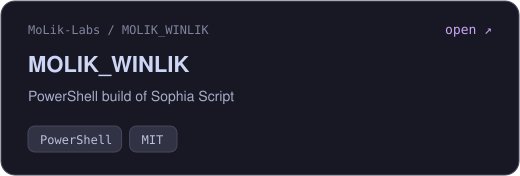
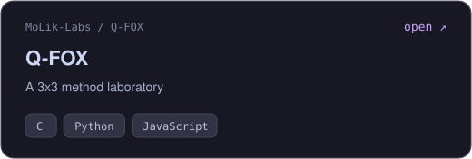

<div align="center">

  <picture>
    <source media="(prefers-color-scheme: dark)" srcset="https://raw.githubusercontent.com/NggKhaiz/NggKhaiz/main/assets/hero-dark.svg">
    <source media="(prefers-color-scheme: light)" srcset="https://raw.githubusercontent.com/NggKhaiz/NggKhaiz/main/assets/hero-light.svg">
    
  </picture>

<p>
  <a href="https://nggkhaiz.js.org"></a>
  <a href="https://nggkhaiz.js.org/labs/"></a>
  <a href="mailto:nggkhaiz@proton.me"></a>
</p>

</div>

### `$ whoami`

```console
nggkhaiz        Nguyễn Gia Khải · he/him · Bắc Giang, Việt Nam
role            independent developer, one maintainer, no roadmap
writes          C · C++ · Zig for the core, Python for the tooling,
                hand-written HTML/CSS/JS for what people actually touch
criteria        read the source, then the changelog
contact         nggkhaiz@proton.me · Discord mental.arc
sites           https://nggkhaiz.js.org · lab: https://nggkhaiz.js.org/labs/
```

I build tools that stay small enough to read: a RandomX miner, a 3×3 cube
laboratory, a study app that fits in one HTML file. I would rather ship a small
honest tool than a large empty one, and every number on this profile and on my
site can be checked against the GitHub API — the figures below are fetched, not
typed.

### `$ ls ~/projects`

<div align="center">

<a href="https://github.com/MoLik-Labs/ZMRIG">
  <picture>
    <source media="(prefers-color-scheme: dark)" srcset="https://raw.githubusercontent.com/NggKhaiz/NggKhaiz/main/assets/projects/zmrig-dark.svg">
    <source media="(prefers-color-scheme: light)" srcset="https://raw.githubusercontent.com/NggKhaiz/NggKhaiz/main/assets/projects/zmrig-light.svg">
    
  </picture>
</a>
<a href="https://github.com/MoLik-Labs/MOLIK_WINLIK">
  <picture>
    <source media="(prefers-color-scheme: dark)" srcset="https://raw.githubusercontent.com/NggKhaiz/NggKhaiz/main/assets/projects/molik-winlik-dark.svg">
    <source media="(prefers-color-scheme: light)" srcset="https://raw.githubusercontent.com/NggKhaiz/NggKhaiz/main/assets/projects/molik-winlik-light.svg">
    
  </picture>
</a>
<a href="https://github.com/MoLik-Labs/Q-FOX-Algorithm">
  <picture>
    <source media="(prefers-color-scheme: dark)" srcset="https://raw.githubusercontent.com/NggKhaiz/NggKhaiz/main/assets/projects/qfox-dark.svg">
    <source media="(prefers-color-scheme: light)" srcset="https://raw.githubusercontent.com/NggKhaiz/NggKhaiz/main/assets/projects/qfox-light.svg">
    
  </picture>
</a>
<a href="https://github.com/MoLik-Labs/STUDY-SITE">
  <picture>
    <source media="(prefers-color-scheme: dark)" srcset="https://raw.githubusercontent.com/NggKhaiz/NggKhaiz/main/assets/projects/study-site-dark.svg">
    <source media="(prefers-color-scheme: light)" srcset="https://raw.githubusercontent.com/NggKhaiz/NggKhaiz/main/assets/projects/study-site-light.svg">
    
  </picture>
</a>

</div>

Everything else that is mine:

- [`NggKhaiz/NggKhaiz`](https://github.com/NggKhaiz/NggKhaiz) — 367 commits · HTML
- [`NggKhaiz/PUBLIC_FILE`](https://github.com/NggKhaiz/PUBLIC_FILE) — 8 commits · Python · 4★
- [`NggKhaiz/RHLZ-PANEL`](https://github.com/NggKhaiz/RHLZ-PANEL) — 5 commits · TypeScript
- [`NggKhaiz/anisette-list`](https://github.com/NggKhaiz/anisette-list) — 1 commit
- [`NggKhaiz/MEDIAFILE_TOOL`](https://github.com/NggKhaiz/MEDIAFILE_TOOL) — 1 commit
- [`NggKhaiz/GOLIKE_TOOL`](https://github.com/NggKhaiz/GOLIKE_TOOL) — 1 commit

Forks are visible on the account and excluded from every total below — their commits are upstream's, not mine.

### `$ cat ~/stack`

| layer | contents |
| :-- | :-- |
| **systems** | C · C++ · Zig · assembly when the compiler stops helping |
| **scripting** | Python · PowerShell · Bash |
| **web** | TypeScript · JavaScript · hand-written HTML and CSS, no framework |
| **data** | SQLite · JSON · plain text files that survive a reinstall |
| **shipping** | git · CMake · Docker · GitHub Actions · GitHub Pages |
| **in the trees** | PowerShell, C, HTML, C++, Python, JavaScript |

<sub>Language mix is measured in bytes across my own repositories only.</sub>

### `$ gh api graphql --jq .data.user`

<div align="center">

  <picture>
    <source media="(prefers-color-scheme: dark)" srcset="https://raw.githubusercontent.com/NggKhaiz/NggKhaiz/main/assets/highlights-dark.svg">
    <source media="(prefers-color-scheme: light)" srcset="https://raw.githubusercontent.com/NggKhaiz/NggKhaiz/main/assets/highlights-light.svg">
    
  </picture>

  <picture>
    <source media="(prefers-color-scheme: dark)" srcset="https://github-profile-summary-cards.vercel.app/api/cards/profile-details?username=NggKhaiz&hide_border=false&utcOffset=7&bg_color=1e1e2e&title_color=cba6f7&text_color=a6adc8&icon_color=cba6f7&chart_color=fab387&border_color=45475a">
    <source media="(prefers-color-scheme: light)" srcset="https://github-profile-summary-cards.vercel.app/api/cards/profile-details?username=NggKhaiz&hide_border=false&utcOffset=7&bg_color=eff1f5&title_color=8839ef&text_color=6c6f85&icon_color=8839ef&chart_color=fe640b&border_color=bcc0cc">
    
  </picture>

</div>

834 contributions in the last year, 7,885 commits in
repositories I own outright, 20 of them public across two accounts.
The strip is drawn by `tools/build_assets.py` from `data/profile.json`; the card
is served live by github-profile-summary-cards with the same hex values. Both
read the GitHub API, so neither can drift.

### `$ tree ~/molik-labs`

The larger work lives in [MoLik-Labs](https://github.com/MoLik-Labs), kept
separate so each repository carries its own documentation, releases and licence:

- **[ZMRIG](https://github.com/MoLik-Labs/ZMRIG)** — RandomX miner, pool and proxy · C / C++ / Zig · GPL-3.0
- **[MOLIK_WINLIK](https://github.com/MoLik-Labs/MOLIK_WINLIK)** — PowerShell build of [Sophia Script](https://github.com/farag2/Sophia-Script-for-Windows) for Windows 10/11 · MIT, upstream credited
- **[Q-FOX](https://github.com/MoLik-Labs/Q-FOX-Algorithm)** — 3×3 method laboratory, one C translation unit · C / Python / JS
- **[Study Focus Fox](https://github.com/MoLik-Labs/STUDY-SITE)** — single-file study app · HTML / JS · MIT

Personal, non-commercial, one maintainer: [nggkhaiz.js.org/labs/](https://nggkhaiz.js.org/labs/).

### `$ cat Makefile`

This profile and [nggkhaiz.js.org](https://nggkhaiz.js.org) are one static site,
generated end to end — the HTML, the SVG cards and every raster image come out
of `tools/`, so nothing under `assets/` is hand-edited.

```bash
python3 tools/fetch_stats.py    # data/profile.json from the GitHub GraphQL API
python3 tools/build_readme.py   # this file
python3 tools/build_assets.py   # hero + project SVGs (Catppuccin Mocha / Latte)
python3 tools/build_images.py   # raster images              (needs pillow)
python3 tools/build_pages.py    # 15 HTML pages, sitemap, manifest, robots
```

Deploying is "upload the repository root": GitHub Pages serves it from `CNAME`,
there is no runtime build and no framework in the bundle. Page map:
[`docs/site-map.md`](docs/site-map.md) · where the numbers come from:
[`docs/data.md`](docs/data.md) · what came from the references and what did not:
[`docs/clone-notes.md`](docs/clone-notes.md) · the contribution graph:
[`docs/graph-art.md`](docs/graph-art.md).

MIT for the code ([`LICENSE`](LICENSE)); the name, portrait and write-ups stay
mine, and each project keeps its own licence.

---

<div align="center">
  <sub>README, cards and site are regenerated by a scheduled workflow — the
  numbers come from the GitHub API and the palette from
  <a href="https://github.com/NggKhaiz/NggKhaiz/blob/main/tools/palette.py">tools/palette.py</a>.</sub>
  <br />
  <sub>The contribution grid is painted by <a href="https://github.com/NggKhaiz/NggKhaiz/blob/main/tools/graph_art.py">tools/graph_art.py</a>
  from a 53×7 text file and a scheduled workflow — nothing hidden, see
  <a href="https://github.com/NggKhaiz/NggKhaiz/blob/main/docs/graph-art.md">docs/graph-art.md</a>.</sub>
  <br />
  <sub>sometimes C++, sometimes Zig, sometimes whatever gets the idea working</sub>
</div>
