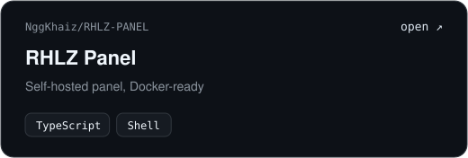
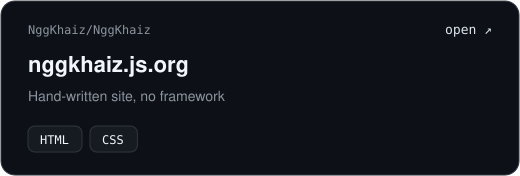
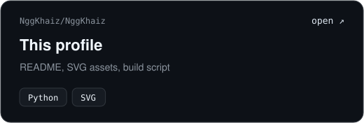
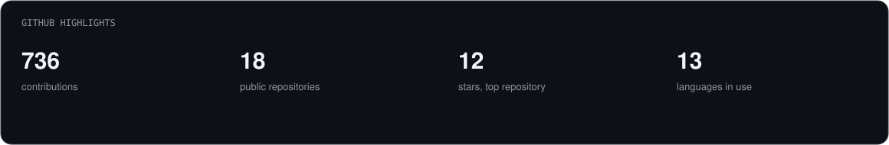

<picture>
  <source media="(prefers-color-scheme: dark)" srcset="https://raw.githubusercontent.com/NggKhaiz/NggKhaiz/main/assets/hero-dark.svg">
  <source media="(prefers-color-scheme: light)" srcset="https://raw.githubusercontent.com/NggKhaiz/NggKhaiz/main/assets/hero-light.svg">
  
</picture>

  
  
  
  

---

<strong>About me</strong>

Hi, I'm **Khải**, I build things because an idea is only worth something once someone else can run it.

My work moves between C++, Python scripts, TypeScript panels and hand-written HTML, depending on what the idea needs. I learn in public and I'd rather ship a small honest tool than a big empty one.

nggkhaiz@proton.me · Discord <code>mental.arc</code> · Bắc Giang, Việt Nam

<strong>Selected work</strong>

Write-ups for each of these: [nggkhaiz.js.org/work](https://nggkhaiz.js.org/work/) · studio pages: [nggkhaiz.js.org/studio](https://nggkhaiz.js.org/studio/)

<a href="https://github.com/NggKhaiz/PUBLIC_FILE">
  <picture>
    <source media="(prefers-color-scheme: dark)" srcset="https://raw.githubusercontent.com/NggKhaiz/NggKhaiz/main/assets/projects/public-file-dark.svg">
    <source media="(prefers-color-scheme: light)" srcset="https://raw.githubusercontent.com/NggKhaiz/NggKhaiz/main/assets/projects/public-file-light.svg">
    
  </picture>
</a>
<a href="https://github.com/NggKhaiz/RHLZ-PANEL">
  <picture>
    <source media="(prefers-color-scheme: dark)" srcset="https://raw.githubusercontent.com/NggKhaiz/NggKhaiz/main/assets/projects/rhlz-panel-dark.svg">
    <source media="(prefers-color-scheme: light)" srcset="https://raw.githubusercontent.com/NggKhaiz/NggKhaiz/main/assets/projects/rhlz-panel-light.svg">
    
  </picture>
</a>

<a href="https://nggkhaiz.js.org">
  <picture>
    <source media="(prefers-color-scheme: dark)" srcset="https://raw.githubusercontent.com/NggKhaiz/NggKhaiz/main/assets/projects/nggkhaiz-site-dark.svg">
    <source media="(prefers-color-scheme: light)" srcset="https://raw.githubusercontent.com/NggKhaiz/NggKhaiz/main/assets/projects/nggkhaiz-site-light.svg">
    
  </picture>
</a>
<a href="https://github.com/NggKhaiz/NggKhaiz">
  <picture>
    <source media="(prefers-color-scheme: dark)" srcset="https://raw.githubusercontent.com/NggKhaiz/NggKhaiz/main/assets/projects/this-profile-dark.svg">
    <source media="(prefers-color-scheme: light)" srcset="https://raw.githubusercontent.com/NggKhaiz/NggKhaiz/main/assets/projects/this-profile-light.svg">
    
  </picture>
</a>

<strong>Toolbox</strong>

<picture>
  <source media="(prefers-color-scheme: dark)" srcset="https://img.shields.io/badge/C++-0D1117?style=flat-square&logo=cplusplus&logoColor=white">
  <source media="(prefers-color-scheme: light)" srcset="https://img.shields.io/badge/C++-F6F8FA?style=flat-square&logo=cplusplus&logoColor=111111">
  
</picture>

<picture>
  <source media="(prefers-color-scheme: dark)" srcset="https://img.shields.io/badge/Python-0D1117?style=flat-square&logo=python&logoColor=white">
  <source media="(prefers-color-scheme: light)" srcset="https://img.shields.io/badge/Python-F6F8FA?style=flat-square&logo=python&logoColor=111111">
  
</picture>

<picture>
  <source media="(prefers-color-scheme: dark)" srcset="https://img.shields.io/badge/TypeScript-0D1117?style=flat-square&logo=typescript&logoColor=white">
  <source media="(prefers-color-scheme: light)" srcset="https://img.shields.io/badge/TypeScript-F6F8FA?style=flat-square&logo=typescript&logoColor=111111">
  
</picture>

<picture>
  <source media="(prefers-color-scheme: dark)" srcset="https://img.shields.io/badge/JavaScript-0D1117?style=flat-square&logo=javascript&logoColor=white">
  <source media="(prefers-color-scheme: light)" srcset="https://img.shields.io/badge/JavaScript-F6F8FA?style=flat-square&logo=javascript&logoColor=111111">
  
</picture>

<picture>
  <source media="(prefers-color-scheme: dark)" srcset="https://img.shields.io/badge/Rust-0D1117?style=flat-square&logo=rust&logoColor=white">
  <source media="(prefers-color-scheme: light)" srcset="https://img.shields.io/badge/Rust-F6F8FA?style=flat-square&logo=rust&logoColor=111111">
  
</picture>

<picture>
  <source media="(prefers-color-scheme: dark)" srcset="https://img.shields.io/badge/HTML-0D1117?style=flat-square&logo=html5&logoColor=white">
  <source media="(prefers-color-scheme: light)" srcset="https://img.shields.io/badge/HTML-F6F8FA?style=flat-square&logo=html5&logoColor=111111">
  
</picture>

<picture>
  <source media="(prefers-color-scheme: dark)" srcset="https://img.shields.io/badge/CSS-0D1117?style=flat-square&logo=css&logoColor=white">
  <source media="(prefers-color-scheme: light)" srcset="https://img.shields.io/badge/CSS-F6F8FA?style=flat-square&logo=css&logoColor=111111">
  
</picture>

<picture>
  <source media="(prefers-color-scheme: dark)" srcset="https://img.shields.io/badge/Shell-0D1117?style=flat-square&logo=gnubash&logoColor=white">
  <source media="(prefers-color-scheme: light)" srcset="https://img.shields.io/badge/Shell-F6F8FA?style=flat-square&logo=gnubash&logoColor=111111">
  
</picture>

<picture>
  <source media="(prefers-color-scheme: dark)" srcset="https://img.shields.io/badge/PowerShell-0D1117?style=flat-square&logo=powershell&logoColor=white">
  <source media="(prefers-color-scheme: light)" srcset="https://img.shields.io/badge/PowerShell-F6F8FA?style=flat-square&logo=powershell&logoColor=111111">
  
</picture>

<picture>
  <source media="(prefers-color-scheme: dark)" srcset="https://img.shields.io/badge/Docker-0D1117?style=flat-square&logo=docker&logoColor=white">
  <source media="(prefers-color-scheme: light)" srcset="https://img.shields.io/badge/Docker-F6F8FA?style=flat-square&logo=docker&logoColor=111111">
  
</picture>

<picture>
  <source media="(prefers-color-scheme: dark)" srcset="https://img.shields.io/badge/Cloudflare_Workers-0D1117?style=flat-square&logo=cloudflareworkers&logoColor=white">
  <source media="(prefers-color-scheme: light)" srcset="https://img.shields.io/badge/Cloudflare_Workers-F6F8FA?style=flat-square&logo=cloudflareworkers&logoColor=111111">
  
</picture>

<picture>
  <source media="(prefers-color-scheme: dark)" srcset="https://img.shields.io/badge/Git-0D1117?style=flat-square&logo=git&logoColor=white">
  <source media="(prefers-color-scheme: light)" srcset="https://img.shields.io/badge/Git-F6F8FA?style=flat-square&logo=git&logoColor=111111">
  
</picture>

<strong>Activity</strong>

<picture>
  <source media="(prefers-color-scheme: dark)" srcset="https://streak-stats.demolab.com?user=NggKhaiz&hide_border=true&background=00000000&ring=DDE6F0&fire=DDE6F0&currStreakLabel=DDE6F0&sideLabels=C9D1D9&dates=8B949E&currStreakNum=C9D1D9&sideNums=C9D1D9">
  <source media="(prefers-color-scheme: light)" srcset="https://streak-stats.demolab.com?user=NggKhaiz&hide_border=true&background=00000000&ring=57606A&fire=57606A&currStreakLabel=57606A&sideLabels=1F2328&dates=656D76&currStreakNum=1F2328&sideNums=1F2328">
  
</picture>

<strong>Highlights</strong>

<picture>
  <source media="(prefers-color-scheme: dark)" srcset="https://raw.githubusercontent.com/NggKhaiz/NggKhaiz/main/assets/highlights-dark.svg">
  <source media="(prefers-color-scheme: light)" srcset="https://raw.githubusercontent.com/NggKhaiz/NggKhaiz/main/assets/highlights-light.svg">
  
</picture>

---

  sometimes C++, sometimes TypeScript, sometimes whatever gets the idea working

