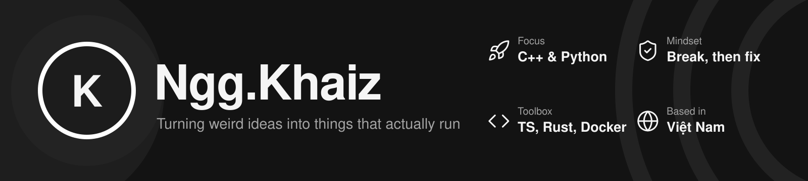
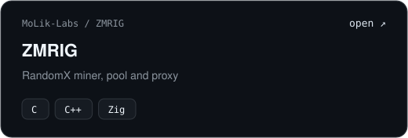
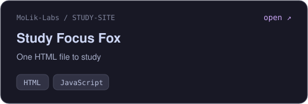
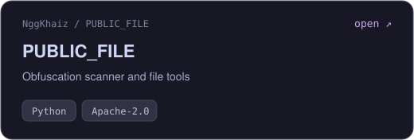

<div align="center">

<picture>
  <source media="(prefers-color-scheme: dark)" srcset="https://raw.githubusercontent.com/NggKhaiz/NggKhaiz/main/assets/hero-dark.svg">
  <source media="(prefers-color-scheme: light)" srcset="https://raw.githubusercontent.com/NggKhaiz/NggKhaiz/main/assets/hero-light.svg">
  
</picture>

<p>
  <a href="https://nggkhaiz.js.org"></a>
  <a href="https://nggkhaiz.js.org/labs/"></a>
  <a href="mailto:nggkhaiz@proton.me"></a>
  
</p>

</div>

---

<p><strong>About me</strong></p>

Hi, I'm **Khải**. I work on my own, mostly close to the machine: C and C++ for the core of things, Zig where that exact speed matters, Python for the tooling around it, and hand-written HTML/CSS/JS for whatever someone else has to look at.

I like repositories bigger than a single script — a RandomX miner, a 3×3 cube laboratory, a study app that fits in one file — and I'd rather ship a small honest tool than a big empty one. Every number on my site can be checked against the GitHub API.

<sub>nggkhaiz@proton.me · Discord <code>mental.arc</code> · Bắc Giang, Việt Nam</sub>

<p><strong>Selected work</strong></p>

<sub>Picked by real commit counts, not by taste. Write-ups: [nggkhaiz.js.org/work](https://nggkhaiz.js.org/work/) · the lab: [nggkhaiz.js.org/labs](https://nggkhaiz.js.org/labs/)</sub>

<div align="center">

<a href="https://github.com/MoLik-Labs/ZMRIG">
  <picture>
    <source media="(prefers-color-scheme: dark)" srcset="https://raw.githubusercontent.com/NggKhaiz/NggKhaiz/main/assets/projects/zmrig-dark.svg">
    <source media="(prefers-color-scheme: light)" srcset="https://raw.githubusercontent.com/NggKhaiz/NggKhaiz/main/assets/projects/zmrig-light.svg">
    
  </picture>
</a>
<a href="https://github.com/MoLik-Labs/Q-FOX-Algorithm">
  <picture>
    <source media="(prefers-color-scheme: dark)" srcset="https://raw.githubusercontent.com/NggKhaiz/NggKhaiz/main/assets/projects/qfox-dark.svg">
    <source media="(prefers-color-scheme: light)" srcset="https://raw.githubusercontent.com/NggKhaiz/NggKhaiz/main/assets/projects/qfox-light.svg">
    
  </picture>
</a>

<a href="https://github.com/MoLik-Labs/STUDY-SITE">
  <picture>
    <source media="(prefers-color-scheme: dark)" srcset="https://raw.githubusercontent.com/NggKhaiz/NggKhaiz/main/assets/projects/study-site-dark.svg">
    <source media="(prefers-color-scheme: light)" srcset="https://raw.githubusercontent.com/NggKhaiz/NggKhaiz/main/assets/projects/study-site-light.svg">
    
  </picture>
</a>
<a href="https://github.com/NggKhaiz/PUBLIC_FILE">
  <picture>
    <source media="(prefers-color-scheme: dark)" srcset="https://raw.githubusercontent.com/NggKhaiz/NggKhaiz/main/assets/projects/public-file-dark.svg">
    <source media="(prefers-color-scheme: light)" srcset="https://raw.githubusercontent.com/NggKhaiz/NggKhaiz/main/assets/projects/public-file-light.svg">
    
  </picture>
</a>

</div>

<p><strong>MoLik Labs</strong></p>

Most of the larger code lives in the [MoLik-Labs](https://github.com/MoLik-Labs) organisation, kept separate so each repository can carry its own docs, releases and licence:

- **[ZMRIG](https://github.com/MoLik-Labs/ZMRIG)** — RandomX miner, pool and proxy · C / C++ / Zig · GPL-3.0 · 4,580 commits
- **[Q-FOX](https://github.com/MoLik-Labs/Q-FOX-Algorithm)** — 3×3 method laboratory, one C translation unit · C / Python / JS
- **[Study Focus Fox](https://github.com/MoLik-Labs/STUDY-SITE)** — single-file study app · HTML / JS · MIT
- **[MOLIK_WINLIK](https://github.com/MoLik-Labs/MOLIK_WINLIK)** — PowerShell build of [Sophia Script](https://github.com/farag2/Sophia-Script-for-Windows) (MIT, upstream credited)

<sub>Personal, non-commercial, one maintainer: [nggkhaiz.js.org/labs](https://nggkhaiz.js.org/labs/)</sub>

<p><strong>Toolbox</strong></p>

<div align="center">

<picture>
  <source media="(prefers-color-scheme: dark)" srcset="https://img.shields.io/badge/C-0D1117?style=flat-square&logo=c&logoColor=white">
  <source media="(prefers-color-scheme: light)" srcset="https://img.shields.io/badge/C-F6F8FA?style=flat-square&logo=c&logoColor=111111">
  
</picture>

<picture>
  <source media="(prefers-color-scheme: dark)" srcset="https://img.shields.io/badge/C++-0D1117?style=flat-square&logo=cplusplus&logoColor=white">
  <source media="(prefers-color-scheme: light)" srcset="https://img.shields.io/badge/C++-F6F8FA?style=flat-square&logo=cplusplus&logoColor=111111">
  
</picture>

<picture>
  <source media="(prefers-color-scheme: dark)" srcset="https://img.shields.io/badge/Zig-0D1117?style=flat-square&logo=zig&logoColor=white">
  <source media="(prefers-color-scheme: light)" srcset="https://img.shields.io/badge/Zig-F6F8FA?style=flat-square&logo=zig&logoColor=111111">
  
</picture>

<picture>
  <source media="(prefers-color-scheme: dark)" srcset="https://img.shields.io/badge/Python-0D1117?style=flat-square&logo=python&logoColor=white">
  <source media="(prefers-color-scheme: light)" srcset="https://img.shields.io/badge/Python-F6F8FA?style=flat-square&logo=python&logoColor=111111">
  
</picture>

<picture>
  <source media="(prefers-color-scheme: dark)" srcset="https://img.shields.io/badge/JavaScript-0D1117?style=flat-square&logo=javascript&logoColor=white">
  <source media="(prefers-color-scheme: light)" srcset="https://img.shields.io/badge/JavaScript-F6F8FA?style=flat-square&logo=javascript&logoColor=111111">
  
</picture>

<picture>
  <source media="(prefers-color-scheme: dark)" srcset="https://img.shields.io/badge/TypeScript-0D1117?style=flat-square&logo=typescript&logoColor=white">
  <source media="(prefers-color-scheme: light)" srcset="https://img.shields.io/badge/TypeScript-F6F8FA?style=flat-square&logo=typescript&logoColor=111111">
  
</picture>

<picture>
  <source media="(prefers-color-scheme: dark)" srcset="https://img.shields.io/badge/HTML-0D1117?style=flat-square&logo=html5&logoColor=white">
  <source media="(prefers-color-scheme: light)" srcset="https://img.shields.io/badge/HTML-F6F8FA?style=flat-square&logo=html5&logoColor=111111">
  
</picture>

<picture>
  <source media="(prefers-color-scheme: dark)" srcset="https://img.shields.io/badge/CSS-0D1117?style=flat-square&logo=css&logoColor=white">
  <source media="(prefers-color-scheme: light)" srcset="https://img.shields.io/badge/CSS-F6F8FA?style=flat-square&logo=css&logoColor=111111">
  
</picture>

<picture>
  <source media="(prefers-color-scheme: dark)" srcset="https://img.shields.io/badge/PowerShell-0D1117?style=flat-square&logo=powershell&logoColor=white">
  <source media="(prefers-color-scheme: light)" srcset="https://img.shields.io/badge/PowerShell-F6F8FA?style=flat-square&logo=powershell&logoColor=111111">
  
</picture>

<picture>
  <source media="(prefers-color-scheme: dark)" srcset="https://img.shields.io/badge/Shell-0D1117?style=flat-square&logo=gnubash&logoColor=white">
  <source media="(prefers-color-scheme: light)" srcset="https://img.shields.io/badge/Shell-F6F8FA?style=flat-square&logo=gnubash&logoColor=111111">
  
</picture>

<picture>
  <source media="(prefers-color-scheme: dark)" srcset="https://img.shields.io/badge/Docker-0D1117?style=flat-square&logo=docker&logoColor=white">
  <source media="(prefers-color-scheme: light)" srcset="https://img.shields.io/badge/Docker-F6F8FA?style=flat-square&logo=docker&logoColor=111111">
  
</picture>

<picture>
  <source media="(prefers-color-scheme: dark)" srcset="https://img.shields.io/badge/Git-0D1117?style=flat-square&logo=git&logoColor=white">
  <source media="(prefers-color-scheme: light)" srcset="https://img.shields.io/badge/Git-F6F8FA?style=flat-square&logo=git&logoColor=111111">
  
</picture>

</div>

<p><strong>Activity</strong></p>

<div align="center">

<picture>
  <source media="(prefers-color-scheme: dark)" srcset="https://streak-stats.demolab.com?user=NggKhaiz&hide_border=true&background=00000000&ring=DDE6F0&fire=DDE6F0&currStreakLabel=DDE6F0&sideLabels=C9D1D9&dates=8B949E&currStreakNum=C9D1D9&sideNums=C9D1D9">
  <source media="(prefers-color-scheme: light)" srcset="https://streak-stats.demolab.com?user=NggKhaiz&hide_border=true&background=00000000&ring=57606A&fire=57606A&currStreakLabel=57606A&sideLabels=1F2328&dates=656D76&currStreakNum=1F2328&sideNums=1F2328">
  
</picture>

</div>

<p><strong>Highlights</strong></p>

<div align="center">

<picture>
  <source media="(prefers-color-scheme: dark)" srcset="https://raw.githubusercontent.com/NggKhaiz/NggKhaiz/main/assets/highlights-dark.svg">
  <source media="(prefers-color-scheme: light)" srcset="https://raw.githubusercontent.com/NggKhaiz/NggKhaiz/main/assets/highlights-light.svg">
  
</picture>

</div>

<p><strong>This repository</strong></p>

This profile and [nggkhaiz.js.org](https://nggkhaiz.js.org) are one static site, generated — the HTML, the SVG cards and every raster image come out of `tools/`, so nothing under `assets/` is hand-edited.

```bash
python3 tools/fetch_fonts.py    # font subsets      (needs fonttools + brotli)
python3 tools/build_images.py   # 20 raster images  (needs pillow)
python3 tools/build_assets.py   # README SVGs
python3 tools/build_pages.py    # 15 HTML pages, copy.js, sitemap, manifest, robots
```

Deploying is "upload the repository root": GitHub Pages serves it from `CNAME`, there is no build step at runtime and no framework in the bundle. Page map: [`docs/site-map.md`](docs/site-map.md) · what came from the reference and what did not: [`docs/clone-notes.md`](docs/clone-notes.md) · the graph: [`docs/graph-art.md`](docs/graph-art.md).

MIT for the code ([`LICENSE`](LICENSE)); the name, portrait and write-ups stay mine, and each project keeps its own licence.

---

<div align="center">
  <sub>The contribution grid above is painted by <a href="https://github.com/NggKhaiz/NggKhaiz/blob/main/tools/graph_art.py">tools/graph_art.py</a> and a scheduled workflow — nothing hidden, see <a href="https://github.com/NggKhaiz/NggKhaiz/blob/main/docs/graph-art.md">docs/graph-art.md</a>.</sub>
  <br />
  <sub>sometimes C++, sometimes Zig, sometimes whatever gets the idea working</sub>
</div>
